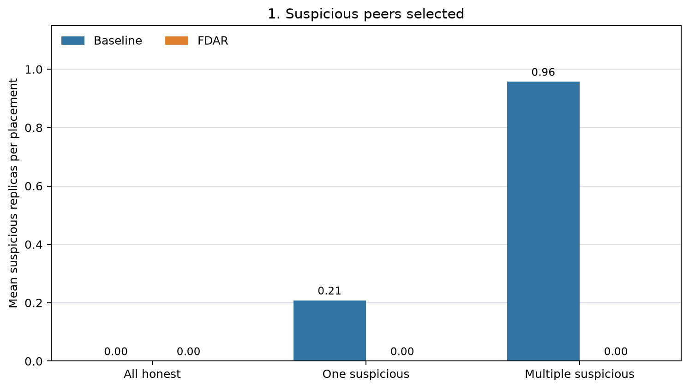
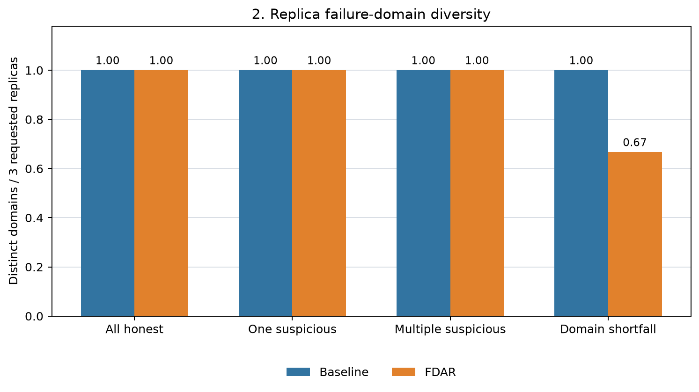
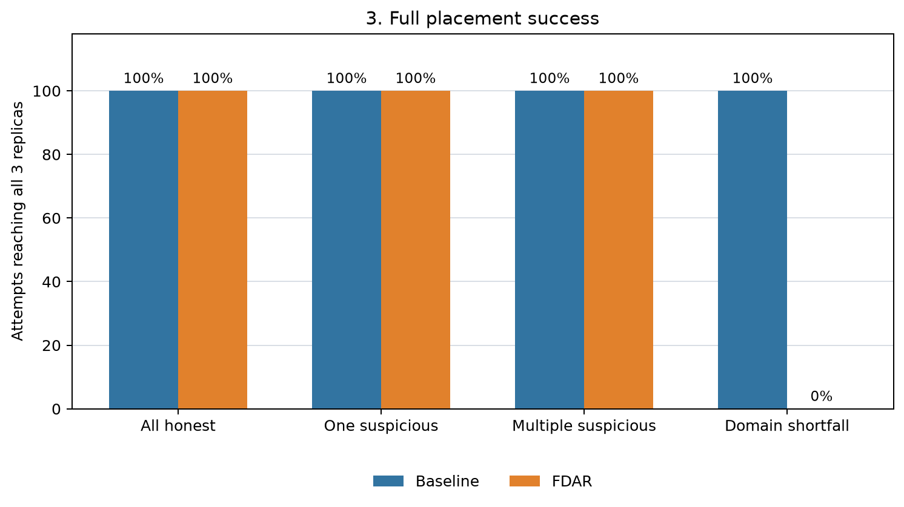
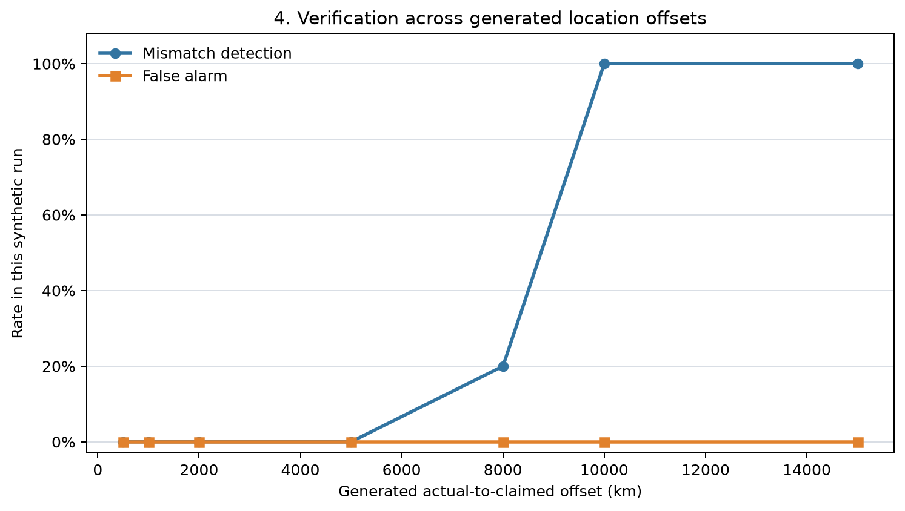

# Synthetic evaluation: main results

This page presents four clear plots that answer the project's main evaluation questions: does verification change replica choices, does placement preserve failure-domain diversity, can it fill the requested replica count, and how does the verifier respond to generated location mismatches?

**All results here are synthetic.** The peers, locations, witness RTT measurements, and labels were generated by the project. They are not real network measurements or evidence of real-world location accuracy. For the remaining diagnostic charts, see [Supplementary synthetic plots](synthetic_results_supplementary.md).

## Main results

### 1. Suspicious peers selected

[Open graph 1](figures/main-results/01_suspicious_selection.png)



This compares the average number of selected replicas whose generated verification status was `SUSPICIOUS`. The baseline bar is about 0.21 for `One suspicious` and 0.96 for `Multiple suspicious`; FDAR is zero in both cases. Both methods are zero in `All honest`. This shows the verification-aware placement avoided selecting suspicious peers in these generated cases. It does not establish that it will do so for real peers.

### 2. Replica failure-domain diversity

[Open graph 2](figures/main-results/02_domain_diversity.png)



The value is distinct selected failure domains divided by the three requested replicas. `1.00` means all three replicas are in distinct domains. FDAR is `0.67` in `Domain shortfall` because only two eligible domains remain; it reports insufficient placement instead of duplicating a domain. The other displayed cases reach `1.00` for both methods.

### 3. Full placement success

[Open graph 3](figures/main-results/03_placement_success.png)



This is the percentage of attempts that placed all three requested replicas. Both methods reach 100% in the honest and suspicious scenarios shown. FDAR reaches 0% in `Domain shortfall`, where its eligibility and domain requirements cannot be met together; the baseline reaches 100% by using the unverified claimed domains. That is the tradeoff between filling every replica slot and applying verification-aware eligibility while preserving domain constraints.

### 4. Verification across generated location offsets

[Open graph 4](figures/main-results/04_distance_sweep_detection.png)



The x-axis is the generated distance between a peer's actual and claimed coordinates. The blue line is the share of generated mismatches classified as suspicious; the orange line is the share of generated non-mismatches classified as suspicious. In this 30-trial run, mismatch detection is 0% at 500, 1,000, 2,000, and 5,000 km; 20% at 8,000 km; and 100% at 10,000 and 15,000 km. The false-alarm rate is 0% at every tested offset. This describes the configured synthetic model and witness layout; it does not establish a real distance threshold.

## Synthetic input data

The evaluation creates its inputs in memory; it does not read a peer dataset or send live pings. The source files are:

- [`configs/evaluation.yaml`](../configs/evaluation.yaml) — peer, witness, sample, trial, seed, scenario, and distance-sweep settings.
- [`configs/default.yaml`](../configs/default.yaml) — Phase 3 latency assumptions and Phase 4 placement policy/scoring settings.
- [`src/location_verifier/experiments/generator.py`](../src/location_verifier/experiments/generator.py) — generated peers, actual and claimed coordinates/domains, witnesses, and synthetic RTT samples.
- [`src/location_verifier/experiments/scenarios.py`](../src/location_verifier/experiments/scenarios.py) and [`runner.py`](../src/location_verifier/experiments/runner.py) — scenario setup and repeated placement runs.
- [`experiments/plot_main_results.py`](../experiments/plot_main_results.py) — produces these four simplified graphs from the saved evaluation records.

The standard evaluation settings are 12 peers, 5 witnesses, 30 RTT samples per peer-witness pair, three requested replicas, building-level failure domains, 10 trials, and 100 objects for the mismatch/multi-object scenarios. The configured seed list is `[42, 43, 44, 45, 46]`; the runner expands it to ten effective trial seeds, recorded in the run manifest. The full scenario list and default distance offsets are in `configs/evaluation.yaml`. The main comparison graphs use the **balanced** policy and focus on honest, suspicious-peer, and domain-shortfall cases; the uncertain-peer policy sweep is left out of the presentation set.

The generator assigns peers across six synthetic building labels (`A1`, `A2`, `A3`, `B1`, `B2`, `C1`) near a Hyderabad anchor coordinate (17.385, 78.4867), with small generated coordinate offsets. A remote mismatch case uses a São Paulo coordinate (-23.5505, -46.6333). The one-suspicious setup changes one peer; the multiple-suspicious and domain-shortfall setups change four and ten peers, respectively, out of twelve. These peers have remote generated actual coordinates but local claimed coordinates and shifted claimed building labels. The domain-shortfall setup therefore leaves two honest candidates for three requested replicas. The non-uncertain scenarios use generated witness locations based on Hyderabad, Delhi, Chennai, Mumbai, and Kolkata; each witness is assigned reliability `0.9`. In the uncertain-peer scenario, witnesses are placed close to the claimed coordinates to exercise the verifier's short-range caution behavior.

For each witness-peer pair, the generator calculates distance from the witness to the peer's **generated actual location**. It predicts RTT using the configured engineering model: an 8 ms baseline plus 0.01 ms per kilometer, with a 15 ms uncertainty half-width that widens by 2 ms per 100 km. Each synthetic sample adds uniform noise from −0.8 to +0.8 ms. These parameters are explicit assumptions, not calibrated network measurements. A suspicious scenario moves one or more peers' generated actual coordinates away from their local claims. The distance sweep moves one peer's actual coordinate by the selected offset while keeping its claimed coordinate and declared failure-domain label fixed.

## Where the input and output files are

The generated input objects are not saved as a separate raw RTT dataset. The runner does save the generated actual/claimed locations and domains, verification statuses, settings, and placement metrics in its per-record output:

- [`data/experiments/evaluation_manifest.json`](../data/experiments/evaluation_manifest.json) — settings, seeds, scenarios, and Phase 3/4 configuration used by the standard run.
- [`data/experiments/raw/evaluation_records.json`](../data/experiments/raw/evaluation_records.json) and [CSV](../data/experiments/raw/evaluation_records.csv) — per-placement generated labels, statuses, and results.
- [`data/experiments/aggregated/evaluation_summary.json`](../data/experiments/aggregated/evaluation_summary.json) — grouped summary values.

Graph 4 uses a separate 30-trial sweep with offsets 500, 1,000, 2,000, 5,000, 8,000, 10,000, and 15,000 km:

- `data/experiments/distance_sweep_extended/evaluation_manifest.json`
- `data/experiments/distance_sweep_extended/raw/evaluation_records.json`
- `data/experiments/distance_sweep_extended/aggregated/evaluation_summary.json`

The JSON and CSV run outputs are generated locally and are not committed to Git because the full standard record file is large. After reproducing the runs, find them at `data/experiments/evaluation_manifest.json`, `data/experiments/raw/evaluation_records.json` and `.csv`, `data/experiments/aggregated/evaluation_summary.json`, and the matching `data/experiments/distance_sweep_extended/` paths. The four simplified graph PNGs are committed under [`docs/figures/main-results/`](figures/main-results/).

## Reproduce the main graphs

From the repository root, generate the standard evaluation, the dedicated 30-trial distance sweep, and these four charts:

```powershell
python experiments/run_evaluation.py --output-dir data/experiments
python experiments/run_evaluation.py --scenario distance_sweep --trials 30 --distance-sweep-km 500,1000,2000,5000,8000,10000,15000 --output-dir data/experiments/distance_sweep_extended
python experiments/plot_main_results.py
```
