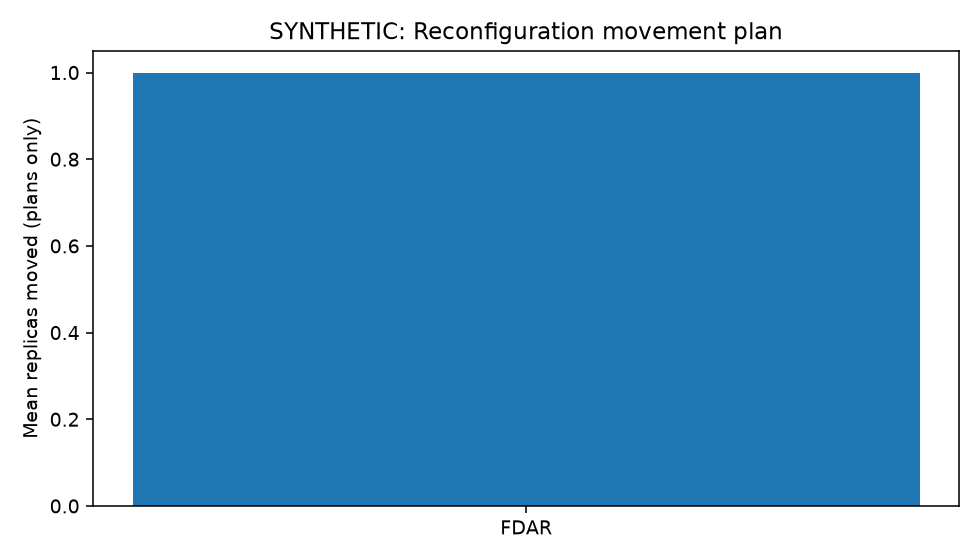
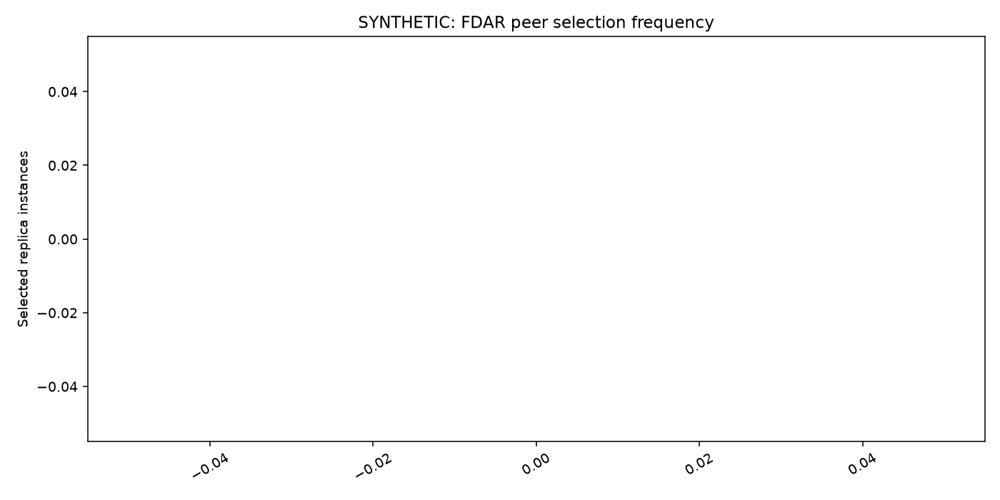
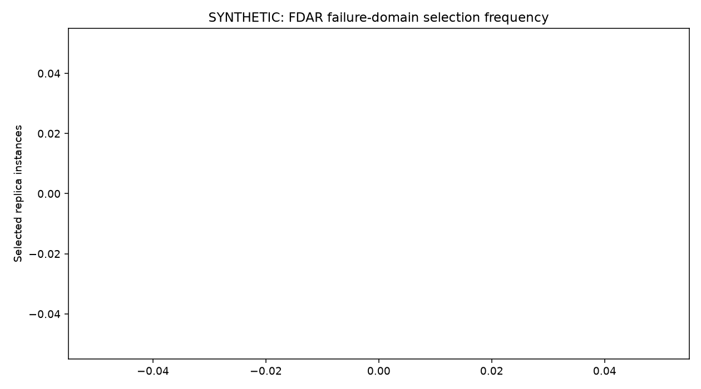
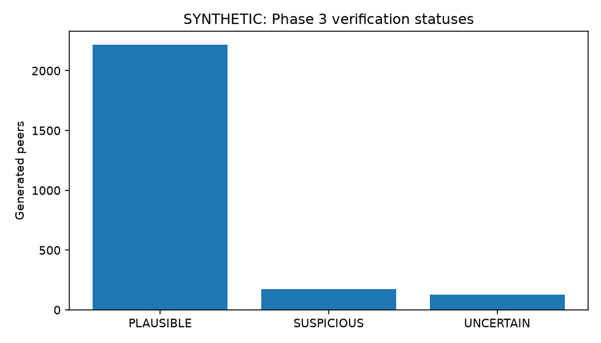
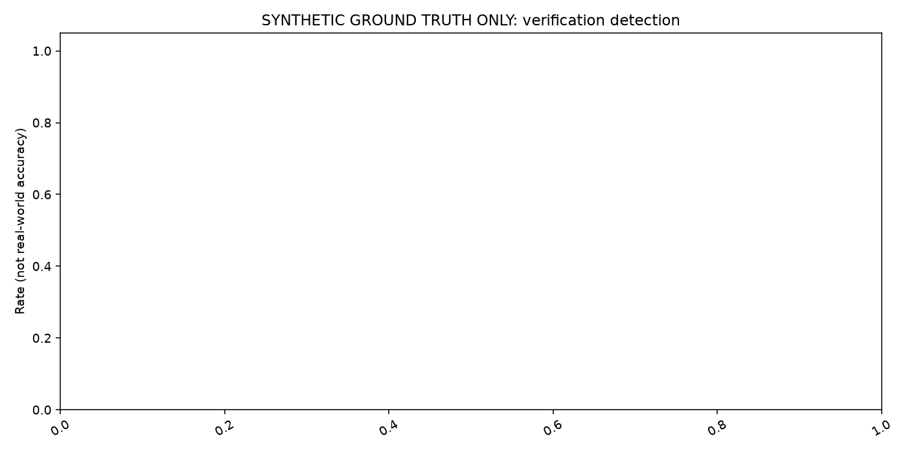

# Supplementary synthetic plots

These five plots provide supporting views of the synthetic evaluation. The four main result graphs and input-data details are in [Synthetic evaluation: main results](synthetic_results.md). All values below are generated by the model and should not be read as real-world accuracy or availability evidence.

## Reconfiguration movement plan

Shows the average number of replica assignments changed in generated FDAR repair plans after a status change. This is a plan only; it does not represent data movement.

## Peer selection frequency

Counts how often each generated peer was selected across the multi-object and repeated-trial scenarios. These counts are not normalized by eligibility or opportunity, so they do not establish fairness.

## Failure-domain selection frequency

Counts selected replicas by generated failure domain. The chart does not account for each domain’s eligible candidates or selection opportunities.

## Verification status distribution

Counts generated peer cases assigned `PLAUSIBLE`, `SUSPICIOUS`, or `UNCERTAIN`. The generated scenario mix determines these counts; they are not expected real-world proportions.

## Generated-label detection and false alarms

Compares verifier classifications with generated mismatch labels. The displayed values apply only to the controlled synthetic scenarios. The legend overlaps the chart, and the false-alarm line at zero is difficult to see.
